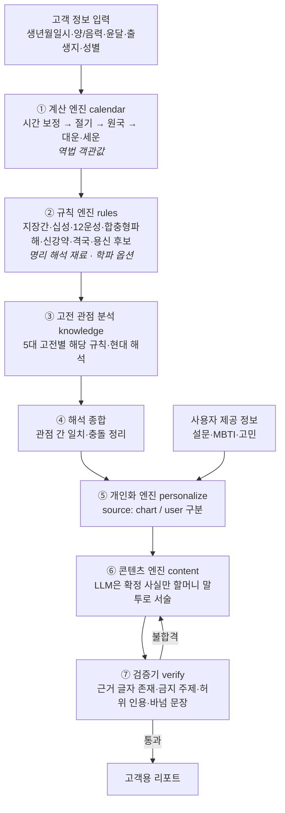

# 시스템 설계 [제안]

## 1. 분석 파이프라인 (엔진 분리 원칙)

| 모듈 | 위치(예정) | AI 사용 | 바꿀 때 영향 |
|---|---|---|---|
| ① 계산 엔진 | `src/engine/calendar/` | 없음 | ②~⑦ 재계산 필요 → `engineVersion` 올림 |
| ② 규칙 엔진 | `src/engine/rules/` | 없음 | ③~⑦ |
| ③ 고전 지식베이스 | `src/engine/knowledge/` + `docs/knowledge/` | 없음(조회) | ④~⑦ |
| ④ 해석 종합 | `src/engine/interpret/` | 없음 | ⑤~⑦ |
| ⑤ 개인화 | `src/engine/personalize/` | 없음 | ⑥~⑦ |
| ⑥ 콘텐츠 | `src/engine/content/` | **있음 (Claude API)** | ⑦ |
| ⑦ 검증기 | `src/engine/verify/` | 선택(보조 검사) | - |

원칙
- ①~⑤는 순수 함수·결정론적. 같은 입력이면 항상 같은 결과.
- 각 단계 결과는 DB에 버전과 함께 저장해, 콘텐츠만 다시 생성하거나 엔진만 업그레이드할 수 있다.
- 기존 `src/lib/saju.ts`, `saju-input.ts`, `generate-reading*.ts`는 새 엔진이 검증될 때까지 유지하고, 교체 시점에 대표 승인 후 정리한다.

### 개인화 엔진
사주 근거(`source: "chart"`)와 사용자 제공(`source: "user"`) 사실을 별도 필드로 전달. 콘텐츠 엔진은 user 사실을 "맞혔다"고 쓰지 못한다.

### 콘텐츠 엔진
> P4-03 1차 구현(2026-11-27, 검증 대기). **운영 라우트에는 아직 연결하지 않았다** — 현행 생성기(`src/lib/generate-reading*.ts`) 교체는 대표 확인 후 별도 작업.

흐름: `computeChart` → `analyzeRules`(운 글자 포함) → `buildPersonalContext` → **`buildFactSheet`**(사실표) → 장 명세(`prompts/`, 콘텐츠 작가) → **`generateChapters`**(장별 생성) → `verifyReading`(장마다) → 저장(운영 연결 시).

| 파일 | 담당 | 내용 |
|---|---|---|
| `src/engine/content/types.ts` | 총괄실장 | 계약: `FactSheet`·`ChapterSpec`·`ChapterResult` |
| `src/engine/content/facts.ts` | 백엔드 | 사실표 생성기(순수 함수) |
| `src/engine/content/generate.ts` | 백엔드 | 장별 생성 파이프라인(Claude API) |
| `src/engine/content/cost.ts` · `schema.ts` | 백엔드 | 모델·단가표·비용 추정 / 받은 JSON 간이 스키마 검사 |
| `src/engine/content/prompts/**` | 콘텐츠 작가 | 시스템 프롬프트·장 명세·상품별 장 구성 |
| `scripts/content/dry-run.{mjs,ts}` | 백엔드 | 미리보기(API 호출 없음): 예시 사실표·장별 프롬프트·토큰/비용 근사 |

**사실표(`buildFactSheet`)**
- 개인정보 최소화: 이름·생년월일(월일)·출생 시각·출생지(이름·경도)를 넣지 않는다. 사람 정보는 호칭(8자 이내, 태그·따옴표 제거)·성별·만 나이·인생 단계·시각 앎 여부만. 엔진 경고문에 섞인 날짜·시각·진태양시 보정 분(경도 추정 가능)은 `sanitizeWarning`이 지우고 의미("월주 경계" 등)만 남긴다.
- 근거 위치 문자열: `year.stem`·`month.branch`, 지장간 `month.branch.jeonggi`(yeogi·junggi·jeonggi), 대운 `daeun[3].stem`(번호 = `luck.daeun[].index`, 1부터), 세운 `seun.branch`.
- 관계(합충형파해)는 원국 + **현재 대운·세운이 낀 것만** 싣는다(사실표 크기 관리). 십성은 원국(지장간 포함)·모든 대운·세운.
- 신강약·용신·조후(rules@0.3.0)는 있으면 옮기고, 없거나 모양이 다르면 생략(방어 읽기). 용신은 관점별 1순위만 병기 — 대표값을 정하지 않는다.
- 사용자 사실은 `personal`에만(배경 전용, `noGuessYears`·`guards` 포함). 사주 쪽 칸에 섞지 않는다.

**장별 생성(`generateChapters(facts, chapters, opts)`)**
- 순차(기본) 또는 동시 2장. 병렬이면 첫 장을 혼자 먼저 돌려 프롬프트 캐시를 만든 뒤 나머지를 돌린다.
- 요청: `system=[{type:"text", text, cache_control:{type:"ephemeral"}}]`, user 메시지 1개, `output_config.format={type:"json_schema", schema}`(SDK 1.8.0 타입에 있음 — 구조화 출력). `temperature`·`budget_tokens`·assistant prefill은 쓰지 않는다. 출력 상한 4096 초과면 `messages.stream().finalMessage()`.
- 스키마가 거부되면(400) 그 장만 "시스템 지시 + JSON 파싱" 방식으로 한 번 전환. 받은 JSON은 `schema.ts`로 한 번 더 확인.
- 재시도: 장마다 최대 2회(429·5xx·연결 오류는 1s→2s 지수 대기·retry-after 존중, 응답 잘림 `max_tokens`는 상한 1.5배, JSON 깨짐·스키마 불일치). `refusal`은 즉시 실패(재시도·내용 생성 없음). SDK 자체 재시도는 끈다(`maxRetries: 0`, 이중 재시도 방지).
- 검증: 장마다 `verifyReading`(장 출력을 장 하나짜리 풀이로 감싸서) → block이면 문제 코드를 붙여 1회 재생성 → 그래도 block이면 실패(출력은 돌려주지 않음). 검증기 오류는 실패로 본다(fail-closed). 검증기는 주입형(`opts.verify`)으로 바꿀 수 있다.
- 제한: 전체 시간 예산(기본 240초, 넘으면 진행 중 요청 취소), 외부 중단 신호(`AbortSignal`), 주문당 호출 상한(기본 장 수 × 4).
- 실패한 장만 다시: `regenerateFailed(facts, chapters, previous)` — ok인 장은 그대로 둔다.
- 기록: 호출마다 `onEvent`(장·시도·모델·토큰·캐시 토큰·추정 비용·결과 코드·소요 시간, 본문·개인정보 없음) → 운영 연결 시 `AiUsage`에 저장. 장 결과에도 합산 `usage.costUsdEstimate`.
- 모델: `opts.model` → 환경변수 `CONTENT_MODEL` → 기본 `claude-opus-5-5`. 허용 목록 `claude-opus-5-5`·`claude-sonnet-5-5`·`claude-haiku-5-5`(날짜 접미사 거부). 단가표는 `cost.ts`(docs/COST_REPORT.md와 함께 고친다). 기본 모델 확정은 대표 결정 사항.
- API 키는 SDK가 환경변수(`ANTHROPIC_API_KEY`)에서 읽는다. 코드·문서·로그에 쓰지 않는다.

**운영 연결 전 남은 일**: 기본 모델 확정(대표), 장 명세 완성(콘텐츠 작가), `AiUsage` 저장·주문별 재생성 횟수 제한을 API 라우트에 연결(백엔드), 실제 API로 소량 시험 호출(대표 승인 후), 품질검증 독립 검증.

### 검증기
출력의 근거 글자가 원국·운에 실제 존재하는지, 금지 주제(사망·중병 시기 등)·투자 조언·허위 고전 인용·누구에게나 맞는 문장이 있는지 검사.

## 2. 인프라

| 구성 | 현재 | 권고 | 비용 |
|---|---|---|---|
| 개발 환경 | Claude Code 웹(클라우드 컨테이너) | 유지. 세션 시작 시 `npm ci` 자동 실행 환경 추가 | 구독 범위 내 |
| 코드 저장소 | GitHub `Jung-Yunju/saju-app` (**공개**) | **비공개 전환** | 무료 |
| 호스팅 | Vercel (Hobby 추정 — 커밋 기록상 60초 제한) | 개발 중 Hobby 유지, **상용 오픈 전 Pro** (Hobby는 비상업용) | Pro $20/월/인 |
| DB | Neon Postgres (`neon.ts`, Prisma) | 유지. Supabase로 바꿀 이유 없음(인증은 NextAuth 사용 중) | 사용량 과금 |
| 인증 | NextAuth v5 + Google | 유지, 카카오 로그인 추가 검토(스키마에 kakaoId 존재) | 무료 |
| 결제 | 토스페이먼츠 (코드만 존재, 미사용 흐름) | 6단계에서 정식 연결 | 가입비·수수료 |
| AI | Anthropic Claude API | 유지. 모델 ID 최신화(Sonnet 5.5 등) | 사용량 과금 |
| 자동 검사(CI) | 없음 | GitHub Actions(타입검사·린트·엔진 테스트) | 공개 저장소 무료 / 비공개 월 무료 한도 내 |

### 환경 분리
- 로컬/클라우드 개발: Neon 브랜치 DB(`neon.ts`에 7일 자동 만료 정책 이미 있음)
- 미리보기(Preview): Vercel 미리보기 + Neon 브랜치
- 운영(Production): 배포는 대표 승인 후에만

### 비밀값 관리
API 키는 Vercel·Neon 환경변수와 Claude Code 환경 설정의 비밀값으로만 저장. 저장소·문서·로그에는 쓰지 않는다. `.env*`는 `.gitignore`에 포함되어 있고 `.claude/settings.json`으로 읽기를 막았다.
