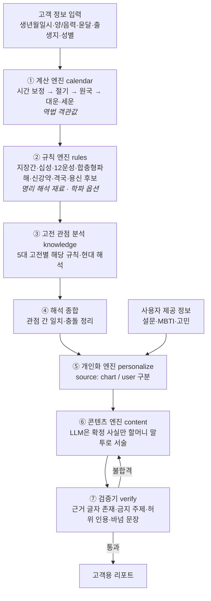

# 시스템 설계 [제안]

## 1. 분석 파이프라인 (엔진 분리 원칙)

| 모듈 | 위치(예정) | AI 사용 | 바꿀 때 영향 |
|---|---|---|---|
| ① 계산 엔진 | `src/engine/calendar/` | 없음 | ②~⑦ 재계산 필요 → `engineVersion` 올림 |
| ② 규칙 엔진 | `src/engine/rules/` | 없음 | ③~⑦ |
| ③ 고전 지식베이스 | `src/engine/knowledge/` + `docs/knowledge/` | 없음(조회) | ④~⑦ |
| ④ 해석 종합 | `src/engine/interpret/` | 없음 | ⑤~⑦ |
| ⑤ 개인화 | `src/engine/personalize/` | 없음 | ⑥~⑦ |
| ⑥ 콘텐츠 | `src/engine/content/` | **있음 (Claude API)** | ⑦ |
| ⑦ 검증기 | `src/engine/verify/` | 선택(보조 검사) | - |

원칙
- ①~⑤는 순수 함수·결정론적. 같은 입력이면 항상 같은 결과.
- 각 단계 결과는 DB에 버전과 함께 저장해, 콘텐츠만 다시 생성하거나 엔진만 업그레이드할 수 있다.
- 기존 `src/lib/saju.ts`, `saju-input.ts`, `generate-reading*.ts`는 새 엔진이 검증될 때까지 유지하고, 교체 시점에 대표 승인 후 정리한다.

### 개인화 엔진
사주 근거(`source: "chart"`)와 사용자 제공(`source: "user"`) 사실을 별도 필드로 전달. 콘텐츠 엔진은 user 사실을 "맞혔다"고 쓰지 못한다.

### 콘텐츠 엔진
- 장(chapter) 단위로 나눠 생성 → 한 번에 긴 응답을 기다리다 시간 초과가 나는 문제 해결.
- 스트리밍 + 장별 저장 + 실패한 장만 재시도.
- 호출마다 모델·입력/출력 토큰·비용을 기록(`AiUsage`).

### 검증기
출력의 근거 글자가 원국·운에 실제 존재하는지, 금지 주제(사망·중병 시기 등)·투자 조언·허위 고전 인용·누구에게나 맞는 문장이 있는지 검사.

## 2. 인프라

| 구성 | 현재 | 권고 | 비용 |
|---|---|---|---|
| 개발 환경 | Claude Code 웹(클라우드 컨테이너) | 유지. 세션 시작 시 `npm ci` 자동 실행 환경 추가 | 구독 범위 내 |
| 코드 저장소 | GitHub `Jung-Yunju/saju-app` (**공개**) | **비공개 전환** | 무료 |
| 호스팅 | Vercel (Hobby 추정 — 커밋 기록상 60초 제한) | 개발 중 Hobby 유지, **상용 오픈 전 Pro** (Hobby는 비상업용) | Pro $20/월/인 |
| DB | Neon Postgres (`neon.ts`, Prisma) | 유지. Supabase로 바꿀 이유 없음(인증은 NextAuth 사용 중) | 사용량 과금 |
| 인증 | NextAuth v5 + Google | 유지, 카카오 로그인 추가 검토(스키마에 kakaoId 존재) | 무료 |
| 결제 | 토스페이먼츠 (코드만 존재, 미사용 흐름) | 6단계에서 정식 연결 | 가입비·수수료 |
| AI | Anthropic Claude API | 유지. 모델 ID 최신화(Sonnet 5.5 등) | 사용량 과금 |
| 자동 검사(CI) | 없음 | GitHub Actions(타입검사·린트·엔진 테스트) | 공개 저장소 무료 / 비공개 월 무료 한도 내 |

### 환경 분리
- 로컬/클라우드 개발: Neon 브랜치 DB(`neon.ts`에 7일 자동 만료 정책 이미 있음)
- 미리보기(Preview): Vercel 미리보기 + Neon 브랜치
- 운영(Production): 배포는 대표 승인 후에만

### 비밀값 관리
API 키는 Vercel·Neon 환경변수와 Claude Code 환경 설정의 비밀값으로만 저장. 저장소·문서·로그에는 쓰지 않는다. `.env*`는 `.gitignore`에 포함되어 있고 `.claude/settings.json`으로 읽기를 막았다.
