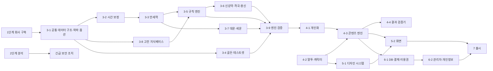

# 전체 개발계획 [제안]

> 기준일 2026-11-27 · 현재 1단계(개발회사 구축) 완료 보고, 대표 승인 대기
> 카드별 상세 상태는 [TASK_BOARD.md](TASK_BOARD.md)

## 1. 목표
「할머니가 풀어 주는 사주」를 **정확한 계산 + 깊이 있는 개인 맞춤 서술**로 유료 결제까지 이어지는 서비스로 만든다. 대표가 코드를 직접 다루지 않아도 AI 개발 조직이 계속 개발·운영할 수 있는 체계를 함께 만든다.

## 2. 단계별 로드맵

| 단계 | 내용 | 주요 투입 직원 | 끝나는 조건 |
|---|---|---|---|
| 1 | 개발회사 구축 | 총괄실장 | 대표 승인 |
| 2 | 기존 개발 결과 분석 | 총괄실장·품질검증 | 분석 보고 (완료) |
| 긴급 | 결제 우회·AI 비용 남용 차단, 화면/AI 사주 불일치 임시 통일 | 백엔드·사주엔진 | 독립 검증 통과 후 배포 승인 |
| 3 | 사주엔진 (만세력·규칙·고전 지식베이스) | 연구소장·엔진·품질검증 | 골든 테스트셋 통과 |
| 4 | 콘텐츠 엔진 (개인화·할머니 말투·검증기) | 개인화·콘텐츠·품질검증 | 샘플 풀이 50건 검증 통과 |
| 5 | 브랜드·웹사이트 | 디자인·프론트엔드 | 모바일 화면 테스트 통과 |
| 6 | 상용 서비스 (회원·결제·이용권·관리자·보안) | 백엔드·사업기획 | 결제 테스트 통과 |
| 7 | 최종 검증·출시 | 품질검증 | 대표 배포 승인 |
| 8 | 지속 개선 | 사업기획·콘텐츠 | 상시 |

## 3. 의존관계

**병렬 가능 구간**: 3-2(엔진 개발자) · 3-4(품질검증) · 3-8(연구소장)은 서로 다른 파일을 다루므로 동시에 진행한다. 4-2(말투)는 3단계와 병렬로 시작할 수 있다.

## 4. 1단계 산출물
- AI 직원 9명 정의(`.claude/agents/`) + 총괄실장(메인 세션)
- 운영규칙(`CLAUDE.md`), 조직도(`AGENTS.md`), 위험 명령 차단(`.claude/settings.json`)
- 문서 14종, 현황판(데이터·생성기·웹 화면)
- 기존 코드 감사 스크립트(`scripts/qa/legacy-engine-audit.sh`)
- 최초 개발계획서(`docs/reports/2026-11-27_initial-plan.md`)

## 5. 기존 개발에서 부족한 부분과 추가 제안
1. **계산 신뢰성**: 화면용·AI용 계산이 따로 있고 서로 다름. 한국 시간대·서머타임·진태양시·윤달 미반영 → 3단계에서 단일 엔진으로 교체.
2. **AI가 규칙까지 판단**: 십성·합충을 AI가 직접 뽑게 되어 있음 → 규칙은 코드, AI는 서술만.
3. **시간 초과 대응을 분량 축소로 해결**: 운영 출력 한도가 1,000토큰까지 줄어 유료 콘텐츠로 부족 → 장별 분할 생성·스트리밍.
4. **결제·보안**: 긴급 조치 필요(대표 보고서 참조).
5. **테스트·CI 없음** → 엔진 단위 테스트 + GitHub Actions 자동 검사 추가(무료 범위).
6. **추가 제안 기능**: 출생지 선택(진태양시), 윤달 선택, "태어난 시 모름" 전용 풀이, 결과 공유 카드(SNS용 이미지), 풀이 다시 보기·연간 업데이트(재방문), 1년 뒤 "맞았나 보기" 알림(기존 review 기능 확장).

## 6. 메뉴 이름 초안 (콘텐츠 작가 투입 시 확정, 대표 승인)
| 일반 명칭 | 할머니식 초안 |
|---|---|
| 본질·성향 | 할미가 본 네 생김새 |
| 인생 총괄 | 네 인생 한 두루마리 |
| 향후 10년 | 앞으로 열 해 날씨 |
| 재물운 | 네 돈주머니 사정 |
| 연애·결혼 | 인연 실타래 |
| 궁합 | 둘이 한 상에 앉으면 |
| 현재 고민 | 할미한테 털어놔 봐 |

## 7. 운영 일정 원칙
- 단계마다 끝에 대표 보고 → 승인 후 다음 단계.
- 일정은 날짜가 아니라 **작업 단위(세부 작업 수)** 로 관리하고, 실제 진행 속도가 쌓이면 날짜 추정을 추가한다.
